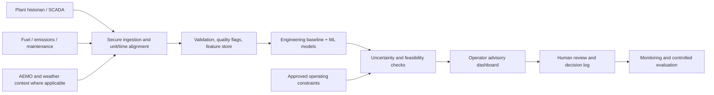

# AI & Data Science for Energy Optimisation

### An Australia-focused use case, applied research proposal and implementation roadmap

**From operating data to safer, more efficient and lower-emissions energy decisions.**


[](https://github.com/Kriti-Data-Business/AI-and-Data-Science-for-Energy-Optimisation)
[](#the-core-use-case)
[](#why-australia-why-now)
[](LICENSE)

> **Project status and evidence boundary:** This repository currently contains a short project description, **two PowerPoint proposal decks**, an illustration, an MIT licence and a **1,000-record sample CSV**. It does **not** contain a trained production model, an optimization engine, a deployed dashboard, verified plant measurements or documented commercial outcomes. This README turns those existing assets into a technically credible **proposed case study** and a practical plan for taking the idea forward. All company applications are **illustrative opportunities**, not claims of client relationships, pilots, endorsements or measured results.

---

## Contents

1. [Executive summary](#executive-summary)
2. [Why Australia, why now?](#why-australia-why-now)
3. [The core use case](#the-core-use-case)
4. [What is actually in this repository?](#what-is-actually-in-this-repository)
5. [Data dictionary and limitations](#data-dictionary-and-limitations)
6. [Australian organisations and application opportunities](#australian-organisations-and-application-opportunities)
7. [Illustrative case study: thermal-unit decision support](#illustrative-case-study-thermal-unit-decision-support)
8. [End-to-end problem-solving methodology](#end-to-end-problem-solving-methodology)
9. [Modelling and optimisation design](#modelling-and-optimisation-design)
10. [Run a first reproducible baseline](#run-a-first-reproducible-baseline)
11. [Architecture and proposed project structure](#architecture-and-proposed-project-structure)
12. [Evaluation, business value and pilot design](#evaluation-business-value-and-pilot-design)
13. [Safety, governance and responsible AI](#safety-governance-and-responsible-ai)
14. [Research, data sources and further reading](#research-data-sources-and-further-reading)
15. [Roadmap and contribution opportunities](#roadmap-and-contribution-opportunities)
16. [Licence and attribution](#licence-and-attribution)

## Executive summary

### The opportunity

Australian electricity generators and industrial energy users must manage **cost, reliability, operational constraints and emissions** simultaneously. A traditional operational review can explain *what happened*; a useful AI-enabled decision-support system should also help engineers understand *what is likely to happen*, *why* and *which safe action merits investigation*.

The proposed solution begins with an approachable thermal-process dataset and develops along three complementary tracks:

| Track | Decision question | Analytical output | Important boundary |
|---|---|---|---|
| **1. Explain** | Which operating variables are associated with changes in the efficiency indicator? | Data-quality findings, distributions, feature relationships and engineering review | Association is not causation. |
| **2. Predict** | Given known process conditions, what efficiency indicator or emissions-class risk might be observed? | Calibrated predictions, error bands and model explanations | The CSV is demonstration data, not validated plant history. |
| **3. Recommend** | Within **engineer-approved operating envelopes**, which candidate adjustments are worth assessing? | Ranked, constrained what-if scenarios for an authorised operator | No autonomous control or physical setpoint changes. |

**Primary use case:** thermal generating units or industrial steam systems, because the existing CSV contains steam temperature, pressure, a fuel-mix variable, an efficiency field and a binary emissions field.

**Adjacent use cases (future projects, requiring different data):** electricity demand forecasting, battery scheduling, renewable-generation forecasting, network congestion, asset-health monitoring and industrial heat electrification. These are not demonstrated by the current CSV.

### What success would look like

An eventual plant pilot would deliver: (i) audited and time-aligned operating data, (ii) trustworthy baseline and challenger models, (iii) engineering-validated recommendations within safety and environmental limits, (iv) evidence of incremental performance against a comparison period, and (v) an auditable decision trail. **No energy, financial or carbon savings are asserted for this repository.**

---

## Why Australia, why now?

Australia is a useful context for this problem because energy-market planning, generation-fleet transition and industrial decarbonisation are happening together:

- The **Australian Energy Market Operator (AEMO)** published its **2026 Integrated System Plan** on **25 June 2026**. Its National Electricity Market (NEM) roadmap considers generation, storage and transmission development to 2050; it creates a planning context for reliable, least-cost transition—not a source of boiler-level sensor measurements. [AEMO 2026 ISP](https://www.aemo.com.au/energy-systems/major-publications/integrated-system-plan-isp/2026-integrated-system-plan-isp)
- The **Australian Energy Regulator's State of the Energy Market 2025** describes the changing wholesale, network, retail and generation environment. Its report and data supplements are useful for **market context and benchmarking**. [AER report](https://www.aer.gov.au/publications/reports/performance/state-energy-market-2025)
- The **Clean Energy Regulator (CER)** publishes National Greenhouse and Energy Reporting (**NGER**) electricity-sector emissions and generation information at a designated-facility level. Such data may support **annual facility-level context**, but cannot replace high-frequency operating or continuous emissions monitoring data. [CER NGER datasets](https://cer.gov.au/markets/reports-and-data/nger-reporting-data-and-registers)
- **CSIRO/AEMO GenCost 2025–26** provides published technology-cost comparisons and electricity-system modelling context. It is relevant for **strategic comparisons**, not as a source of site-specific efficiency improvement estimates. [CSIRO GenCost](https://www.csiro.au/en/research/technology-space/energy/electricity-transition/gencost)
- **ARENA** describes both renewable process-heat options and industrial heat electrification pathways, giving this work a longer-term role beyond improving fossil-fuelled processes. [Industrial process heat](https://arena.gov.au/knowledge-bank/renewable-energy-options-for-industrial-process-heat/) · [Electrifying industrial heat](https://arena.gov.au/electrify-heat/)

### Scope: NEM versus Western Australia

The **NEM** covers interconnected eastern and southern market regions (Queensland, New South Wales, the ACT within NSW, Victoria, South Australia and Tasmania). **Western Australia's Wholesale Electricity Market (WEM) / South West Interconnected System is not part of the NEM.** AEMO operates relevant systems and publishes separate data resources, but NEM spot prices, dispatch records and regional identifiers must **not** be directly applied to WA operations. Choose the market and data pipeline that match the site.

---

## The core use case

### Problem statement

> **How might a generating plant or industrial steam system use historical process conditions to identify inefficient operating regimes, flag possible emissions risk, and evaluate potential adjustments—without compromising safety, availability, environmental compliance or operator control?**

### Intended users

**Power-station operations engineers**, **performance engineers**, **maintenance/reliability engineers**, **environmental specialists**, **asset managers**, and **energy-trading teams** where commercial decisions intersect with technical operating envelopes.

### Decisions in scope

- Quantify the relationship between steam temperature/pressure, fuel characteristics and an agreed efficiency measure.
- Identify anomalies, operating clusters and possible poor-performance periods.
- Estimate efficiency and/or the likelihood of a clearly defined emissions threshold event.
- Compare *feasible* hypothetical operating points with the current or reference state.
- Prioritise investigations and maintenance opportunities for expert review.

### Decisions out of scope for the present sample

No claims are made about real-world plant thermodynamics, measured greenhouse-gas tonnes, plant safety margins, dispatch performance, outage avoidance or actual savings. The proposed system must not directly operate valves, burners, boilers, turbines or distributed control systems (DCS) without a separate, approved engineering and safety process.

---

## What is actually in this repository?

```text
AI-and-Data-Science-for-Energy-Optimisation/
├── README.md                               # This project overview / case-study plan
├── AI_Energy_Optimization_Professional.pptx # Presentation asset
├── AI_Energy_Optimization_Proposal.pptx     # Presentation asset
├── Data_Science_Energy_Optimization.png     # Existing illustration
├── sample_energy_data.csv                  # 1,000 data rows; 5 columns
└── LICENSE                                 # MIT
```

| Existing asset | How to use it |
|---|---|
| [`sample_energy_data.csv`](sample_energy_data.csv) | Explore the schema, prototype EDA and run introductory ML baselines. |
| [`AI_Energy_Optimization_Proposal.pptx`](AI_Energy_Optimization_Proposal.pptx) | Supporting presentation asset to review alongside this project narrative. |
| [`AI_Energy_Optimization_Professional.pptx`](AI_Energy_Optimization_Professional.pptx) | Additional stakeholder/presentation asset. |
| [`Data_Science_Energy_Optimization.png`](Data_Science_Energy_Optimization.png) | Existing visual used above. |
| [`LICENSE`](LICENSE) | Terms for the repository's MIT-licensed content. |

**Not currently present:** Python source modules, notebooks, `requirements.txt`, tests, an API, a dashboard, model artifacts, operational data connections or an experiment-results report. Sections below specify **suggested implementation**, not completed work.

---

## Data dictionary and limitations

The CSV currently contains **1,000 records and the following five columns**:

| Column (exact CSV name) | Observed representation | Proposed interpretation to validate with a data owner | Caution |
|---|---|---|---|
| `Steam_Temperature` | Continuous numeric | Steam-temperature-related measurement | **No measurement unit, sensor location or calibration metadata.** Do not assume °C or the measurement point. |
| `Steam_Pressure` | Continuous numeric | Steam-pressure-related measurement | **No pressure unit or absolute/gauge convention.** Do not assume bar, MPa or psi. |
| `Fuel_Mix` | Continuous numeric, roughly 0–1 | A fuel-composition feature or normalized index | It is **not documented** as a coal/gas share, biomass percentage or multi-fuel category. |
| `Efficiency` | Continuous numeric, roughly 0.70–1.00 | Sample efficiency score or proxy target for regression | **Not validated as actual net electrical/thermal efficiency.** Values near 1 are especially inappropriate to present as credible thermal-to-electric plant efficiencies. |
| `Emissions` | Binary `0`/`1` | A possible classification label for demonstration | **Not measured CO₂, CO₂-e, NOx, SO₂ or a known regulatory exceedance.** Meaning of positive class and threshold is unspecified. |

**Data provenance:** The repository does not document how these records were collected or generated. Their numeric appearance is consistent with demonstration-style data, but the exact generation process is **unverified**. Treat them as **illustrative/unverified sample data**, not operational measurements or emissions evidence.

**Missing for defensible industrial modelling:** timestamps and timezone, equipment/unit IDs, operating mode, fuel type and calorific value, load (MW), electrical output and fuel input, ambient conditions, sensor units and quality flags, start-up/shutdown indicators, planned/unplanned outage indicators, plant control limits, maintenance events, measured emissions units/labels, data lineage and permissions.

### Minimum data contract for a future pilot

| Domain | Required examples | Why needed |
|---|---|---|
| Plant telemetry (historian / SCADA) | UTC timestamp; unit ID; load; steam T/P with units; flows; boiler/turbine variables | Explain operating state and align sensor records. |
| Fuel and heat balance | Fuel type, heating value, mass/volume flow, heat input, gross/net electricity | Define **real** heat rate and efficiency consistently. |
| Environmental monitoring | Pollutant identity, mass/concentration, reference conditions, continuous monitoring and QA flags | Build a meaningful regulatory or environmental target. |
| Maintenance and reliability | Work orders, derates, starts, trips and condition alarms | Separate process changes from equipment degradation. |
| Market/weather context | Region-specific dispatch/price, weather, demand where relevant | Avoid attributing system-driven changes to plant setpoints. |
| Governance | Data owner, retention, access, consent/contract permissions, change log | Establish auditable and lawful data use. |

**Definition before modelling:** Real *net electrical efficiency* requires a physically valid equation such as `net electrical energy output / fuel energy input` over a consistent interval. *Heat rate* may be represented as `fuel energy input (GJ) / net electrical energy (MWh)`; lower values indicate less fuel per MWh. Define boundary conditions and calculation standards with the plant engineer before using either metric. The sample `Efficiency` column is **not** a substitute.

---

## Australian organisations and application opportunities

The following are **potential application fits**, chosen because their publicly described portfolios or institutional roles relate to the decisions being explored. **None is stated to be a user, partner, sponsor or participant in this project.** “Fit” is a hypothesis for discovery discussions, not a ranking or evidence of procurement interest.

### Energy producers and retailers: where a site-level pilot could fit

| Organisation | Relevant public operating context | Hypothetical decision-support use case | Source |
|---|---|---|---|
| **Stanwell** (QLD) | Tarong/Tarong North thermal generation; supercritical technology at Tarong North | Analyse steam operating envelopes, abnormal heat-rate patterns and operator-reviewed efficiency opportunities | [Tarong power stations](https://www.stanwell.com/tarong-power-stations) |
| **CS Energy** (QLD) | Callide B / Kogan Creek generation assets | Predict inefficient plant states; combine validated unit data with availability and maintenance events | [Thermal generation](https://www.csenergy.com.au/what-we-do/power-generation) |
| **AGL Energy** (NSW/VIC) | Bayswater and Loy Yang A thermal operations plus transition plans | Compare heat-rate and emissions-intensity trends across units and operating regimes | [Hunter region](https://www.agl.com.au/about-agl/operations/agl-in-the-hunter) · [Latrobe Valley](https://www.agl.com.au/about-agl/operations/agl-in-the-latrobe-valley) |
| **EnergyAustralia** (NSW) | Mt Piper coal-fired generation and related energy projects | Engineer-reviewed boiler/turbine performance analytics and plant-condition monitoring | [Mt Piper](https://www.energyaustralia.com.au/about-us/what-we-do/generating-energy/mt-piper-power-station) |
| **Origin Energy** (NSW) | Eraring generation and battery-development context | Study thermal-unit performance during changing load patterns, then separately extend to storage optimisation using new data | [Eraring power station](https://www.originenergy.com.au/about/who-we-are/what-we-do/generation/eraring-power-station/) |
| **Alinta Energy** (VIC/WA) | Loy Yang B and Pinjarra cogeneration: electricity **and steam** production | Industrial steam and combined-heat-and-power efficiency modelling; WA work requires WA-specific market data | [Power generation portfolio](https://www.alintaenergy.com.au/about-us/power-generation) |

**Priority discovery hypothesis:** A single, instrumented **thermal unit or cogeneration site** is the best first implementation candidate; more generic retailer, wind, solar or battery use cases require fundamentally different input features and outputs.

### System operators, regulators, research and funding organisations

| Organisation | What it can contribute to a research-grade approach | What it does **not** provide here |
|---|---|---|
| **AEMO** | NEM dispatch, price, regional demand and forecasting context; planning via the ISP | Private plant historian or full turbine/boiler sensor logs. |
| **AER** | Market-performance, network and consumer-context publications | Proof that a model improves an individual station. |
| **CER** | Published NGER facility-level emissions/generation and emissions-intensity context | A replacement for site-specific high-frequency emissions monitors. |
| **ARENA** | Industrial process heat, electrification and demonstration-project research | A guarantee of project funding or endorsement. |
| **CSIRO** | Cost, transition and modelling research (including GenCost) | Site-specific operating parameters or a ready-to-deploy process controller. |

Potential **later-stage** research beneficiaries include electricity networks (e.g., congestion/DER analytics), but a network project needs feeder/transformer and demand data rather than the steam-process CSV.

---

## Illustrative case study: thermal-unit decision support

**Case-study title:** *Finding safe efficiency opportunities in an Australian steam-generating unit*

**Case-study type:** Proposed scenario, **not** a historical client engagement.

### 1. Business context

A hypothetical generating-site performance team sees variation in fuel consumption and the operating performance of a steam unit as load, ambient conditions and equipment health change. It wants to prioritise investigations and distinguish normal operating variability from potentially avoidable inefficiency.

### 2. Business question

> For a specified load and equipment condition, can the team reliably identify **suboptimal efficiency or emissions-risk regimes** and shortlist **feasible alternatives** for engineering review?

### 3. Stakeholders and success criteria

- **Operations manager:** maintain dispatch readiness, alarm discipline and safe operating bounds.
- **Performance engineer:** understand heat-rate drivers and confidence in the recommendation.
- **Environmental manager:** verify correctly defined pollutant limits and measurement quality.
- **Asset/reliability manager:** identify degradation requiring maintenance rather than setpoint changes.
- **Commercial manager:** estimate value only after reliability, operational and carbon consequences are accounted for.

**Acceptance hypothesis:** Improve a meaningful forecasting metric against a documented naive baseline; independently verify **safety-envelope compliance** for every proposed scenario; demonstrate a measurable improvement in a separately approved, controlled pilot. Numerical targets must be approved with the site team after assessing baseline performance and sensor quality.

### 4. Illustrative analytical sequence

1. **Observe:** collect temperature, pressure, heat input, net output, load, fuel characteristics and measured emissions with timestamps.
2. **Validate:** reject impossible measurements, quality-flag unreliable sensors and document gaps.
3. **Establish baseline:** compare against existing plant heat-balance calculations and simple statistical models.
4. **Explain drivers:** segment stable operating regimes by load and operating mode; review changes with engineers.
5. **Predict:** estimate next-period efficiency/heat rate or probability of a defined risk event using only information available at decision time.
6. **Simulate:** evaluate multiple **approved** candidate points under fixed load, ramp, equipment and environmental limits.
7. **Review:** make a ranked operator advisory with evidence, uncertainty and rollback option.
8. **Validate impact:** test on shadow-mode data first, then only consider an approved and controlled trial.

### 5. Example decision card- **hypothetical only**

| Field | Illustration (not a measured recommendation) |
|---|---|
| Operating mode | Steady-load regime approved by plant engineering |
| Current state | Unit operating inside existing authorised setpoint envelope |
| Model observation | A validated performance model flags a potentially unfavorable combination of operating factors |
| Proposed action | **Investigate** an alternative, engineer-approved operating point; no automatic actuation |
| Required guardrails | Boiler/turbine limits, ramp limits, emissions constraints, minimum load, equipment condition |
| Evidence | Model version, feature values, uncertainty interval, comparison with historical similar states |
| Outcome | **To be determined by controlled evaluation**; no savings figure assumed |

### 6. Why this is a valuable case study even before deployment

It demonstrates how to translate a broad promise (“AI will optimise energy”) into a **specific decision**, a **measurable physical target**, an **operationally constrained method** and an **evidence plan**. It also highlights a critical professional lesson: models trained on undocumented or synthetic-looking observations cannot establish industrial performance or environmental impact.

---

## End-to-end problem-solving methodology

| Phase | Key question and activities | Deliverable / gate |
|---|---|---|
| **0- Frame the decision** | Which site/unit, operating mode and decision horizon? Who can approve actions? | Problem charter, stakeholder map, safety boundary, business KPI definition. |
| **1- Secure and understand data** | Inventory historian, fuel, CEMS, event and maintenance data; agree on owners, units and retention. | Data-access approval, source catalog, data dictionary and lineage. |
| **2- Audit and engineer features** | Join on time/unit; mark sensor faults; calculate load, heat rate, rolling averages and stable-state flags. | Validated training table and rejected-record report. |
| **3- Build baselines** | Compare rule-based/engineering baseline, naive regression, simple classifier and optional anomaly detection. | Holdout metrics and error analysis by site, load band and season. |
| **4- Challenge with ML** | Trial interpretable models first, then nonlinear models only if justified. | Reproducible models, uncertainty/calibration, explanations and model card. |
| **5- Screen operating choices** | Generate candidate scenarios **only within explicit engineering constraints**. | Feasibility checker and ranked, human-readable what-if cards. |
| **6- Shadow mode** | Run advisory without plant action; compare predictions with reality and operator feedback. | Safety/performance sign-off and documented limitations. |
| **7- Controlled pilot** | Follow formal site change-management processes, measure outcomes with a comparator. | Pilot evaluation, go/no-go recommendation and rollback procedure. |
| **8- Operate and iterate** | Monitor drift, sensor quality, alert volume and operating-regime changes. | Model monitoring, periodic retraining approval and audit trail. |

### Data-science questions to resolve explicitly

**Target ambiguity:** Is the objective *net heat rate*, *net efficiency*, *fuel cost per MWh*, or *probability of a specific monitored emissions exceedance*? Each requires a different dataset and metric.

**Temporal leakage:** A target defined at `t+1` cannot rely on measurements or maintenance outcomes recorded after the prediction cut-off. The current sample has **no timestamps**, so it can only support an illustrative **random-split exercise**, not trustworthy future forecasting.

**Confounding:** Pressure, temperature and load may respond to each other and to operator decisions. Correlation and ML feature importance are not proof that manually changing a setpoint will improve a plant. Engineer-reviewed system identification or controlled causal evaluation is necessary before action.

**Distribution shift:** Startups, shutdowns, derates, fuel changes and overhaul periods may invalidate a model built on steady-state observations. Segment, monitor and fail safely outside the validated regime.

---

## Modelling and optimisation design

### Model families (proposed, not yet implemented in the repository)

| Layer | Example methods | Outputs | Evaluation |
|---|---|---|---|
| Exploratory | Histograms, scatterplots, quality rules, correlations, operating-mode segmentation | Data-quality and exploratory findings | Domain review / reproducibility |
| Efficiency-score regression | Dummy/mean baseline, regularised linear regression, random forest, gradient boosting | Predicted score **on sample data**; real heat rate after target redesign | MAE, RMSE, R² and error by operating regime |
| Binary label classification | Majority-class baseline, logistic regression, random forest | Likelihood of sample `Emissions=1`; **not** a CO₂ concentration | Precision, recall, PR-AUC, Brier score, calibration, false-alert impact |
| Anomaly/asset analytics | Rules, isolation forest, residual monitoring | Unusual behaviour for expert triage | Engineer-reviewed detection yield, false positives |
| Advisory optimisation | Scenario enumeration or constrained optimisation over an engineering-approved surrogate model | Ranked **candidate** operating envelopes | Constraint satisfaction, uncertainty, operational and environmental sign-off |

### Advisory mathematical formulation (future validated data only)

For a plant-state vector `x` and candidate controls `u`, an advisory may screen:

```text
Minimise    J(u | x) = w_fuel * predicted_fuel_cost(u, x)
                      + w_emis * predicted_emissions_cost(u, x)
                      + w_risk * operational_risk_penalty(u, x)

Subject to: u in engineer_approved_operating_envelope(x)
            temperature/pressure/load/ramp constraints are respected
            unit availability and maintenance restrictions are respected
            environmental constraints are respected
            predicted uncertainties remain acceptable
            an authorised human reviews any resulting recommendation
```

The weights, constraints and physical equations would be defined **with** operations and compliance teams. Never optimise the sample's binary `Emissions` label as though it were tonnes of CO₂-e; never interpret its unvalidated `Efficiency` score as actual plant conversion efficiency.

### Evaluation strategy

1. **Sample-only demonstration:** stratified random holdout for the binary label, ordinary holdout for the score; compare to naive models. Report random seed, sample count and metric uncertainty. Results are **not** evidence of plant generalisation.
2. **Real pilot data:** time-based train/validation/test cut-offs, with seasonal coverage and blackout/gap around leakage-prone events; separate unit/site holdouts if generalising across assets.
3. **Safety and calibration:** out-of-distribution detection, prediction intervals, false-alert burden and constraint audits.
4. **Human factors:** measure the fraction of recommendations judged actionable, rejected, or requiring data repair; maintain approval and override logs.
5. **Causal impact:** predefine comparison windows and appropriate controls for load, weather, fuel and outages before estimating business benefits.

---

## Run a first reproducible baseline

**Current state:** There is no committed training script or requirements file. The following self-contained snippet can be run **after cloning the repository** to show an honest *sample-data* baseline. It trains one simple model for each label, compares against naive baselines, and prints only calculated scores. It does not optimise a plant or make a real emissions estimate.

### 1. Clone and install minimal demonstration dependencies

```bash
git clone https://github.com/Kriti-Data-Business/AI-and-Data-Science-for-Energy-Optimisation.git
cd AI-and-Data-Science-for-Energy-Optimisation

python -m venv .venv
# macOS / Linux:
source .venv/bin/activate
# Windows PowerShell: .venv\Scripts\Activate.ps1

python -m pip install pandas scikit-learn
```

### 2. Inspect and model the existing CSV

```bash
python - <<'PY'
import pandas as pd
from sklearn.dummy import DummyClassifier, DummyRegressor
from sklearn.ensemble import RandomForestClassifier, RandomForestRegressor
from sklearn.metrics import (
    mean_absolute_error, roc_auc_score, average_precision_score,
    balanced_accuracy_score,
)
from sklearn.model_selection import train_test_split

csv = pd.read_csv('sample_energy_data.csv')
features = ['Steam_Temperature', 'Steam_Pressure', 'Fuel_Mix']
X = csv[features]

print('Dataset shape:', csv.shape)
print('Missing values:', csv.isna().sum().to_dict())
print('Emissions label counts:', csv['Emissions'].value_counts().to_dict())

# Synthetic/unverified efficiency-score regression; not physical efficiency.
y_score = csv['Efficiency']
X_train, X_test, y_train, y_test = train_test_split(
    X, y_score, test_size=0.20, random_state=42
)
for name, model in [
    ('mean baseline', DummyRegressor(strategy='mean')),
    ('random forest', RandomForestRegressor(n_estimators=200, random_state=42, n_jobs=-1)),
]:
    model.fit(X_train, y_train)
    print(f'Efficiency-score MAE ({name}): {mean_absolute_error(y_test, model.predict(X_test)):.4f}')

# Binary demonstration label; not a pollutant mass or certified exceedance.
y_label = csv['Emissions']
X_train, X_test, y_train, y_test = train_test_split(
    X, y_label, test_size=0.20, stratify=y_label, random_state=42
)
for name, model in [
    ('prior baseline', DummyClassifier(strategy='prior')),
    ('random forest', RandomForestClassifier(n_estimators=200, random_state=42, n_jobs=-1)),
]:
    model.fit(X_train, y_train)
    probability = model.predict_proba(X_test)[:, 1]
    predicted = model.predict(X_test)
    print(f'Binary label ({name}): balanced accuracy={balanced_accuracy_score(y_test, predicted):.3f}, '
          f'ROC-AUC={roc_auc_score(y_test, probability):.3f}, '
          f'average precision={average_precision_score(y_test, probability):.3f}')
PY
```

> **Interpretation:** If a random-forest model performs similarly to—or worse than—the naive baseline, report that finding. Do not fabricate lift or savings. With this undated and undocumented sample, even a better holdout score demonstrates only a statistical pattern in these sample records.

For serious work, pin dependencies, add tests, track experiment seeds and build a **time-aware pipeline** only after obtaining timestamped measurements. Windows users can run the same Python code from a local `.py` file if their shell does not support `<<'PY'` heredocs.

---

## Architecture and proposed project structure

### Target architecture (**conceptual, not deployed**)



**Protection boundary:** Integrations to DCS/OT environments require separate security architecture, authorisation and safety engineering. The advisory should initially be **read-only, offline or shadow-mode**.

### Suggested future repository layout (**not yet committed**)

```text
data/
  raw/                 # Access-controlled plant exports (do not commit sensitive data)
  processed/           # Validated analytical tables
notebooks/
  01_data_audit.ipynb
  02_exploration.ipynb
src/
  data/                # Ingestion, validation and feature contracts
  models/              # Baselines, model training and evaluation
  advisory/            # Constraint checks and what-if screening
  monitoring/          # Drift, quality and human-feedback tracking
tests/                  # Schema, leakage and constraint checks
reports/                # Model cards, evaluation evidence, pilot design
requirements.txt        # Version-pinned dependencies
```

This layout is a development suggestion, **not** a statement that these directories or files exist today.

---

## Evaluation, business value and pilot design

### Measurement hierarchy

| Level | Example metric | Correct interpretation |
|---|---|---|
| **Dataset** | Completeness, sensor-quality rate, timestamp alignment | Trustworthiness of the input. |
| **Model** | MAE for physical heat rate; calibrated emissions risk; drift | Quality of prediction on withheld **real** operations. |
| **Recommendation** | % feasible, operator acceptance, false alerts, constraint violations | Quality and practicality of advice. |
| **Plant** | Net heat rate (GJ/MWh), fuel use, availability, measured tCO₂-e/MWh or relevant pollutant-specific limit | Observed site outcome, corrected for comparability. |
| **Business** | Avoided fuel spend, avoided downtime, net incremental margin, implementation cost | Credible, finance-reviewed benefit **after** validation. |

### Transparent value model- example formulas, not results

```text
Fuel cost avoided (AUD)
  = verified reduction in fuel energy input (GJ) × applicable fuel cost (AUD/GJ)

Emissions change (t CO2-e)
  = measured / approved-accounting baseline emissions
    − measured / approved-accounting pilot emissions

Net pilot value (AUD)
  = validated financial benefits − implementation and operating costs
    − any offsetting reliability, compliance or production impacts
```

Apply corrections for **generation output, ambient conditions, fuel quality, operating regime and outages**. Avoid double counting fuel/emissions benefits and distinguish gross from net generation. A binary class label cannot enter the emissions formula.

### Proposed pilot evaluation protocol

- **Pre-register** the intervention, outcomes, comparison groups and safety stop conditions with plant stakeholders.
- Establish a **baseline period** and a sufficiently comparable evaluation period across load bands and modes.
- Start with **shadow recommendations**; document operator acceptance, rejection and reason codes.
- Obtain necessary plant engineering, OT security, environmental and safety approvals before any controlled physical trial.
- Track both leading and adverse measures: fuel use, heat rate, unplanned alarms, availability, pollutant monitors, operator workload and incidents.
- Publish only authorised, aggregated results. Clearly label unmeasured, estimated and observed impacts.

---

## Safety, governance and responsible AI

Operational energy settings are a **high-consequence environment**. A good model is not, by itself, an authorisation to change plant operation.

**Non-negotiable controls:**

1. **Human decision authority:** outputs are advice to trained engineers/operators, not closed-loop autonomous instructions.
2. **Engineering envelope:** hard constraints from site procedures, equipment OEM limits and environmental obligations are not learned solely from training data.
3. **Fail-safe behavior:** suppress recommendations on missing sensors, uncertain predictions, abnormal operating modes or out-of-distribution inputs.
4. **Cyber/OT boundaries:** read-only interfaces first; follow site OT security and change-control processes; avoid direct public-cloud access to control networks without approval.
5. **Auditability:** maintain model/data versions, input snapshot, uncertainty, constraint results, decision maker and outcome.
6. **Emissions integrity:** use the correct pollutant, units, time aggregation, monitoring method and Australian reporting methodology. Do not call sample labels measured carbon emissions.
7. **Privacy, IP and licences:** validate the right to use operational/vendor data; do not commit confidential plant exports or secrets.
8. **Australian guidance:** use the National AI Centre's [Guidance for AI Adoption](https://www.ai.gov.au/staying-safe-and-responsible/essential-ai-practices/guidance-ai-adoption-implementation-guidance) for governance, risk, testing and human oversight; also consult the [Australian AI Ethics Principles](https://www.industry.gov.au/publications/australias-ai-ethics-principles).

Before deployment, obtain independent assessment under the operator's applicable safety, environment, cyber and regulatory frameworks. This README is **not** engineering, legal, compliance or financial advice.

---

## Research, data sources and further reading

The links below are **primary-source starting points** for scoping and validation. Publications and websites change; check release dates, datasets, usage conditions and source definitions when incorporating them into a study. **Public AEMO/CER data should not be mistaken for time-synchronised internal plant telemetry.**

### Australian energy-market and emissions evidence

1. **AEMO- 2026 Integrated System Plan**, published 25 June 2026: [ISP and supporting materials](https://www.aemo.com.au/energy-systems/major-publications/integrated-system-plan-isp/2026-integrated-system-plan-isp). Use for long-term system and policy context.
2. **AEMO- NEM data index:** [Data (NEM)](https://www.aemo.com.au/energy-systems/electricity/national-electricity-market-nem/data-nem). Use to locate generation, load, metering, network, forecasting and MMS data.
3. **AEMO- Dispatch:** [Five-minute market dispatch data and formats](https://aemo.com.au/energy-systems/electricity/national-electricity-market-nem/data-nem/market-management-system-mms-data/dispatch). Use for timestamped NEM dispatch context where relevant.
4. **AEMO- Market Data/NEMWeb:** [NEMWeb](https://visualisations.aemo.com.au/aemo/nemweb/). Check current/archive availability, schema and use notices.
5. **AER- State of the Energy Market 2025:** [report and supporting resources](https://www.aer.gov.au/publications/reports/performance/state-energy-market-2025). Use for Australian wholesale, network and retail market analysis.
6. **CER- NGER data and registers:** [published electricity-sector emissions and generation](https://cer.gov.au/markets/reports-and-data/nger-reporting-data-and-registers). Use to contextualise annual facility emissions intensity, subject to reporting definitions and coverage.
7. **CER- About emissions and energy data:** [definitions and publishing scope](https://cer.gov.au/schemes/national-greenhouse-and-energy-reporting-scheme/about-emissions-and-energy-data). Use for understanding reporting boundaries.
8. **CSIRO/AEMO- GenCost 2025–26:** [technology cost and modelling research](https://www.csiro.au/en/research/technology-space/energy/electricity-transition/gencost). Use for strategic comparisons, not operational optimization labels.

### Thermal systems, industrial transformation and AI

9. **Stanwell- Tarong power stations:** [plant technology and steam-cycle context](https://www.stanwell.com/tarong-power-stations); [how generation works](https://www.stanwell.com/info-hub/article/how-energy-is-generated-at-tarong-power-stations). Use as an Australian example of why temperature and pressure matter physically; **sample CSV units do not come from this source**.
10. **ARENA- Renewable Energy Options for Industrial Process Heat:** [research report and appendices](https://arena.gov.au/knowledge-bank/renewable-energy-options-for-industrial-process-heat/). Use when comparing efficiency projects with fuel switching and electrification.
11. **ARENA- Electrifying Industrial Heat:** [industrial heat research and practical material](https://arena.gov.au/electrify-heat/). Use for longer-term decarbonisation opportunities.
12. **ARENA- National Industrial Transformation Program:** [objectives and funding information](https://arena.gov.au/funding/national-industrial-transformation-program/). Use for policy/program context; **eligibility and funding must be checked directly**.
13. **International Energy Agency- Energy and AI (2025):** [energy-sector opportunities and energy demands of AI](https://www.iea.org/reports/energy-and-ai). Use for broader AI-system trade-offs.
14. **National AI Centre- Guidance for AI Adoption:** [higher-risk implementation guidance](https://www.ai.gov.au/staying-safe-and-responsible/essential-ai-practices/guidance-ai-adoption-implementation-guidance). Use for governance, testing, oversight and accountability.
15. **Australian Government- AI Ethics Principles:** [responsible AI principles](https://www.industry.gov.au/publications/australias-ai-ethics-principles). Use alongside operator standards and applicable law.

### Australian business/asset research (illustrative opportunity mapping)

- [Stanwell- Tarong/Tarong North](https://www.stanwell.com/tarong-power-stations)
- [CS Energy- thermal generation portfolio](https://www.csenergy.com.au/what-we-do/power-generation)
- [AGL- Hunter / Bayswater operations](https://www.agl.com.au/about-agl/operations/agl-in-the-hunter)
- [AGL- Latrobe Valley / Loy Yang A](https://www.agl.com.au/about-agl/operations/agl-in-the-latrobe-valley)
- [EnergyAustralia- Mt Piper](https://www.energyaustralia.com.au/about-us/what-we-do/generating-energy/mt-piper-power-station)
- [Origin Energy- Eraring](https://www.originenergy.com.au/about/who-we-are/what-we-do/generation/eraring-power-station/)
- [Alinta Energy- generation and cogeneration](https://www.alintaenergy.com.au/about-us/power-generation)

### Methods to implement and document

- [scikit-learn- model evaluation](https://scikit-learn.org/stable/modules/model_evaluation.html)- select metrics appropriate to regression/classification and baseline prevalence.
- [scikit-learn- common pitfalls](https://scikit-learn.org/stable/common_pitfalls.html)- leakage, preprocessing and reproducibility.
- [scikit-learn- probability calibration](https://scikit-learn.org/stable/modules/calibration.html)- when classification probabilities will inform review thresholds.

---

## Roadmap and contribution opportunities

### Milestones (proposed)

- [x] Publish initial concept assets and a sample CSV.
- [x] Frame the Australian use case and research/engineering questions in this README.
- [ ] Document sample-data provenance, units, label definitions and intended generation method.
- [ ] Add data-audit notebook, dataset card and schema tests.
- [ ] Add baseline experiments, reproducible environment and measured sample-only results.
- [ ] Add engineering-reviewed feature definitions and cross-validation tests.
- [ ] Identify a consenting pilot partner and obtain lawful, suitable operational data.
- [ ] Build physically meaningful heat-rate/emissions targets from verified measurements.
- [ ] Validate time-split models, uncertainty and safety constraints.
- [ ] Prototype a **read-only** advisory dashboard and operator feedback workflow.
- [ ] Evaluate a shadow-mode pilot, document findings and decide whether controlled testing is warranted.
- [ ] Explore a separately scoped industrial heat electrification or battery-optimisation study.

### Suggested first GitHub issues

| Issue | Definition of done |
|---|---|
| `data: document sample schema and provenance` | CSV dictionary includes units (or explicitly unknown), targets, label definitions, source and licensing. |
| `analysis: add EDA notebook` | Reproducible missing-value, distribution, correlation and plausibility review. |
| `ml: add baseline experiments` | Fixed seed, train/test strategy, dummy baselines, metric tables, limitations. |
| `engineering: define decision constraints` | Signed-off operating envelopes, excluded operating modes, reject/fail-safe rules. |
| `research: map Australian public datasets` | Source, geographic coverage, granularity, availability, join keys and usage licence. |
| `governance: publish sample model card` | Intended use, prohibited uses, model limitations, testing and human oversight. |

**How to contribute:** Open an issue describing the site or subproblem, data availability, proposed model and validation approach. For pull requests, include reproducibility instructions and explicitly separate **demonstration outputs** from **verified plant outcomes**. Never add confidential operational records, access credentials or partner-identifying material without authorisation.

---

## Licence and attribution

This repository includes an [MIT licence](LICENSE). The README links to external research and organisations for context; **their material, datasets, trademarks and linked assets remain subject to their own terms**. Brand names are used solely to describe hypothetical industry application areas. No affiliation or endorsement is implied.

**Repository:** [Kriti-Data-Business / AI-and-Data-Science-for-Energy-Optimisation](https://github.com/Kriti-Data-Business/AI-and-Data-Science-for-Energy-Optimisation)

**Research context checked:** 19 October 2026. For technical or commercial use, recheck source dates, reporting definitions, asset status and operational requirements before relying on them.

---

**The intended progression:** *Sample data → explicit engineering problem → validated measurements → reliable forecasts → constrained operator advice → independently measured impact.*
